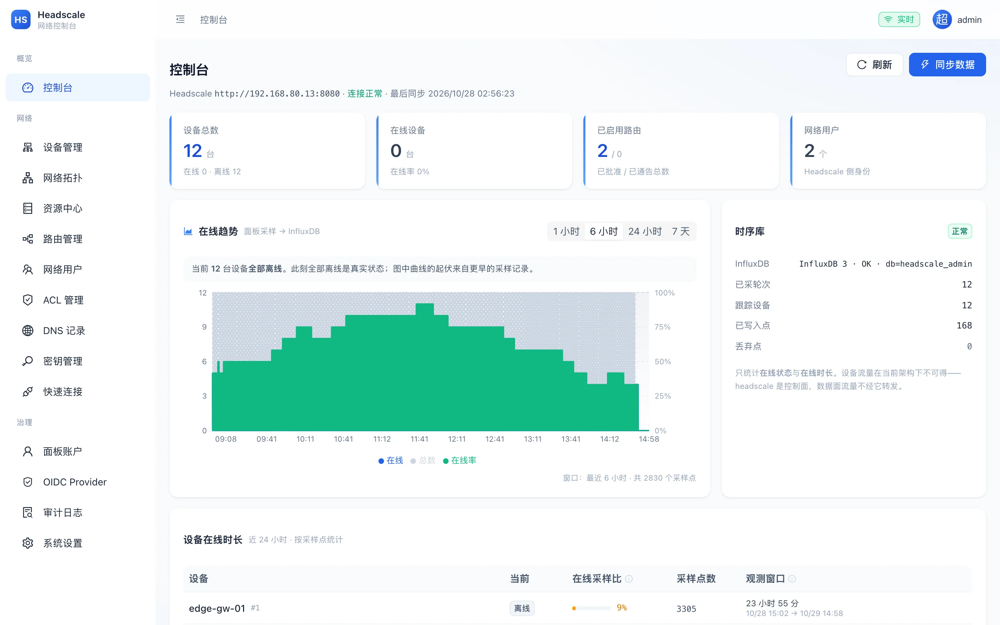
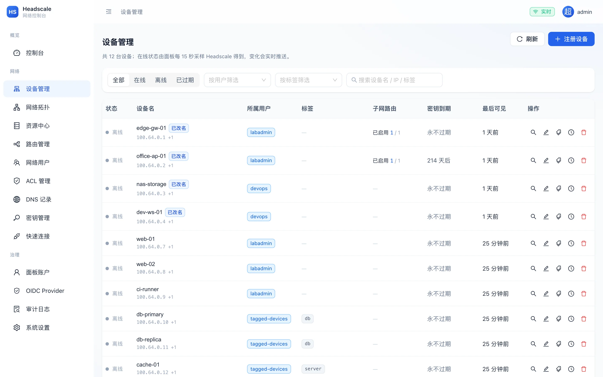
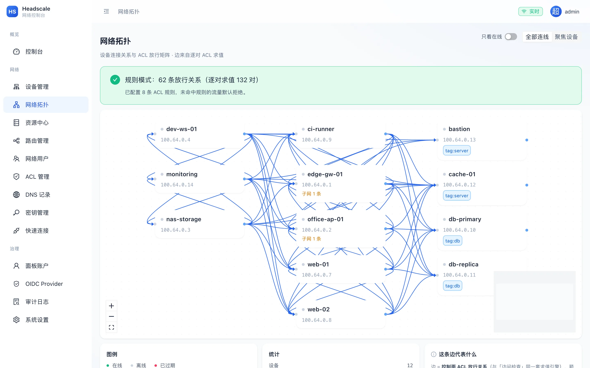
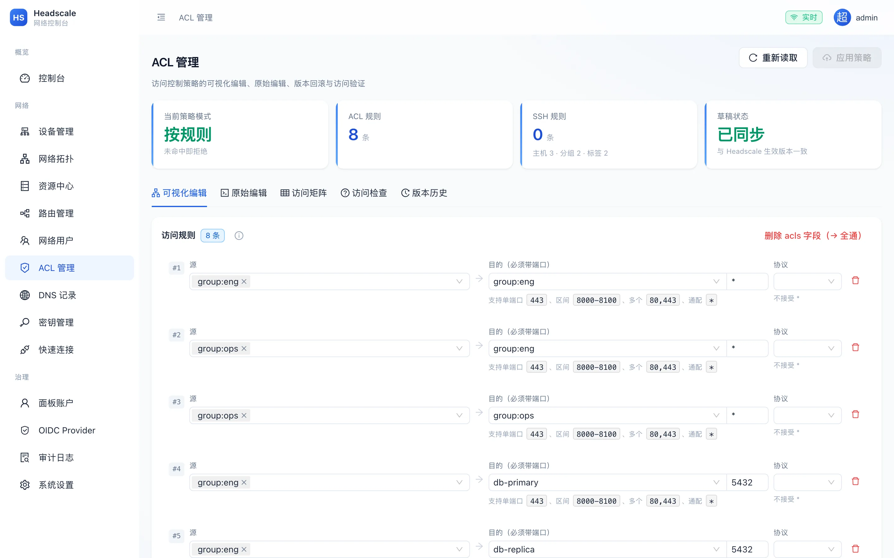
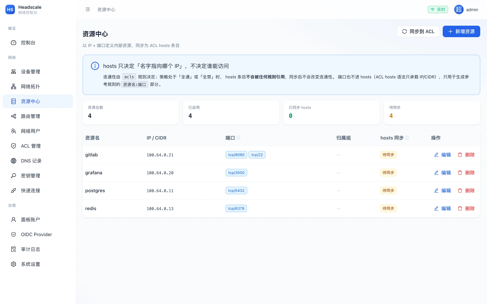
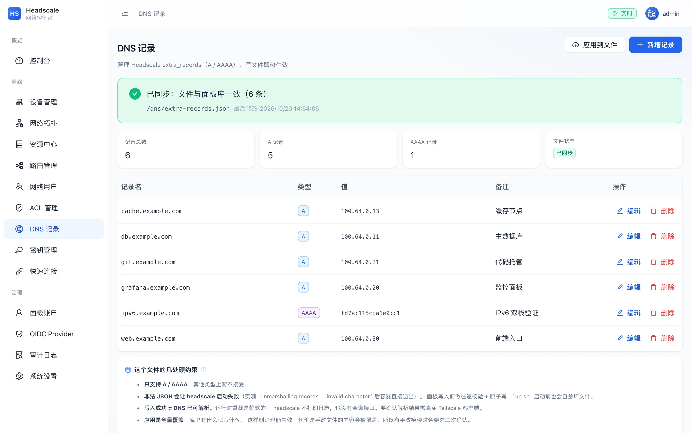
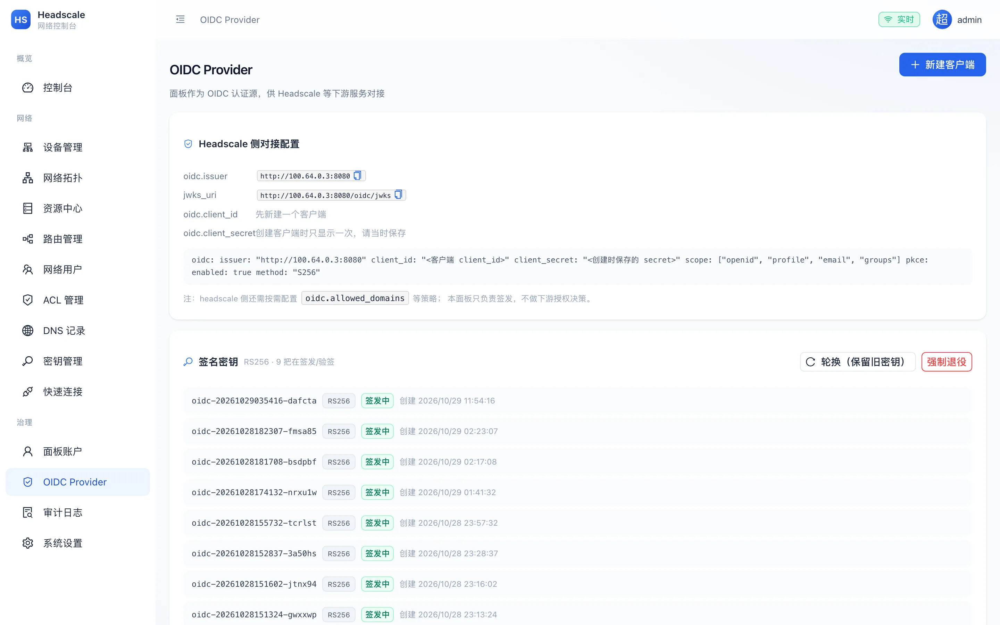
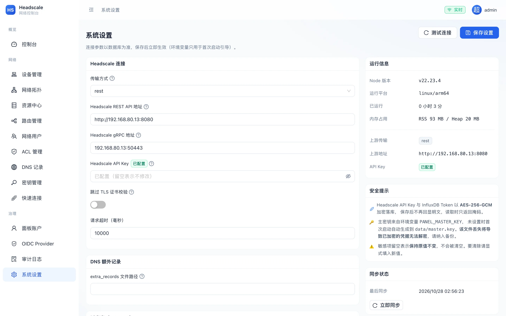
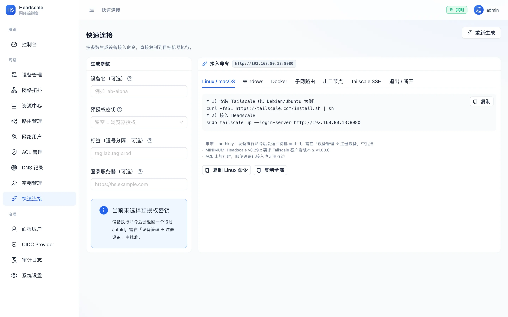
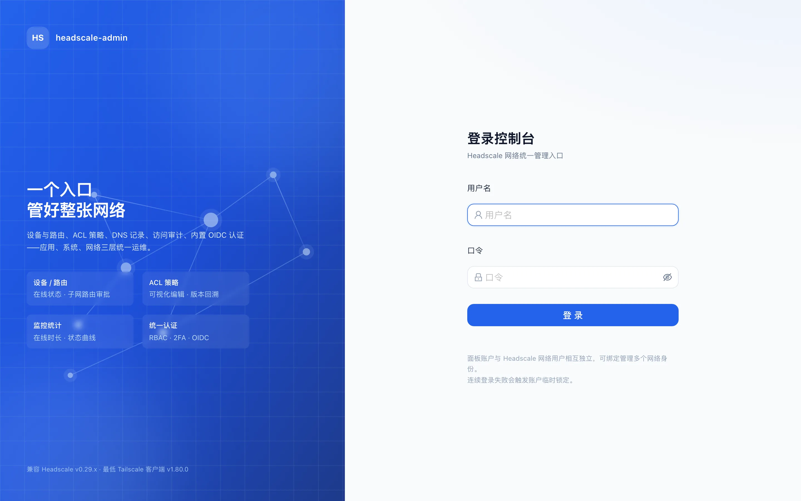

# headscale-admin

基于 **Headscale v0.29.6** 的 Web 管理面板。应用 / 系统 / 网络三层统一运维入口。

> 所有 API 用法均在真实 headscale v0.29.6 实例上实测验证，踩坑记录见
> [`docs/headscale-v0.29-api-notes.md`](docs/headscale-v0.29-api-notes.md)。

---

## 界面一览

> 截图取自真实运行实例：12 台设备、8 条 ACL 规则、InfluxDB 3.x 已接入。
> 设备显示「离线」是真实状态（合成节点无实际 tailscaled 连接），
> 趋势图的起伏来自历史采样——面板不会为了让界面好看而伪造在线状态。

[](docs/images/dashboard.webp)

**控制台**：在线趋势（面板每 15 秒采样 → InfluxDB 3.x）、设备在线时长排行、时序库健康状况。
曲线来自真实采样点，采集断了会直接显示「无数据」而不是画一条假线。

| | |
|---|---|
| [](docs/images/nodes.webp) | [](docs/images/topology.webp) |
| **设备管理**：状态 / 标签 / 子网路由 / 密钥到期，支持按用户与标签筛选。打标签后归属显示 `tagged-devices`，这是 headscale 的真实语义（标签即身份，脱离原用户） | **网络拓扑**：每一条边都是 ACL 逐对求值的结果（图中 132 对求值出 62 条放行），不是画个示意图 |
| [](docs/images/acl.webp) | [](docs/images/resources.webp) |
| **ACL 管理**：可视化编辑 / 原始 HuJSON / 访问矩阵 / 访问检查 / 版本历史五个视角。删除 `acls` 字段会翻成「全通」，所以那一步要求二次确认 | **资源中心**：以「名字 + IP + 端口」登记内部资源，一键同步为 ACL `hosts` 条目。页面顶部明确写了 hosts 只决定「名字指向哪个 IP」，不决定谁能访问 |
| [](docs/images/dns.webp) | [](docs/images/oidc.webp) |
| **DNS 记录**：管理 headscale `extra_records`（仅 A/AAAA），写文件后靠 fsnotify 热生效。页面底部列出了几处硬约束，比如非法 JSON 会让 headscale 直接启动失败 | **OIDC Provider**：面板自己作为认证源，直接生成可粘贴进 headscale 配置的 YAML，含 JWKS 地址与签名密钥轮换 |
| [](docs/images/settings.webp) | [](docs/images/connect.webp) |
| **系统设置**：连接参数以数据库为准，环境变量只用于首次启动引导。API Key 与 InfluxDB Token 以 AES-256-GCM 加密落库，读取时只返回掩码 | **快速连接**：按参数生成接入命令，覆盖 Linux/macOS、Windows、Docker、子网路由、出口节点、Tailscale SSH |



**登录**：本地账户 + TOTP 双因素。用服务端会话而非纯 JWT，换来「可撤销」——禁用账户或改密后立即踢下线。

---

## 能力边界（先说清楚，不夸大）

headscale 本身做不到的事，本面板不会假装能做：

| 需求 | 现实 | 面板做法 |
|------|------|---------|
| 设备/用户/密钥/路由/ACL 管理 | ✅ API 完整 | 直接对接 REST `/api/v1/*` |
| ACL 访问检查 | ⚠️ `policy/check` 只校验语法语义 | 面板自研规则求值引擎 |
| ACL 版本历史 | ❌ 无 API | 面板自建版本库 |
| 实时推送 | ❌ 无流式 API | 面板轮询上游 + WebSocket 扇出 |
| DNS extra_records | ⚠️ 无写 API，但 v0.29 有 fsnotify 文件监听 | 写文件 → 热生效 |
| 每节点流量字节 | ❌ headscale 不转发数据，物理上统计不到 | 接口返回 **501 + 原因说明**，不编造数据；替代方案见下 |
| 在线时长 | ⚠️ 可从 `online` 状态迁移推算 | 采样器 + InfluxDB，精度 = 采样间隔 |

---

## 架构

```
浏览器 (React SPA)
   │  REST + Cookie        WebSocket
   ▼                          ▼
┌──────────────────────────────────────────┐
│  headscale-admin 面板 (Fastify + Node)    │
│  ├─ 会话/RBAC/2FA    ├─ ACL 引擎与版本库   │
│  ├─ WS Hub           ├─ 状态采样器         │
│  └─ 内置 OIDC Provider├─ 资源中心          │
└────┬──────────────┬──────────────┬────────┘
     │ REST         │ 写文件        │ line protocol
     ▼              ▼              ▼
 Headscale      extra-records   InfluxDB 3.x
 v0.29.6       (fsnotify 热加载)  (未配置则降级 SQLite)
```

## 技术选型与取舍

| 层 | 选型 | 理由 / 取舍 |
|----|------|------------|
| 后端 | Node 22 + TypeScript + Fastify | 全栈同语言；管理面低 QPS，Node 够用。放弃 Go：功能广度上开发效率差距太大 |
| 面板库 | Node 内置 `node:sqlite` | **零原生编译依赖**（国内网络下 better-sqlite3 的 prebuild 常下载失败）。代价：Node 22 中标记 experimental，故用仓储层封装，将来可无痛换 Postgres |
| 时序库 | InfluxDB **3.12.1 Core**（line protocol 写入 + SQL 查询） | 写入量大、读模式是聚合查询。3.x 已移除 Flux，官方明确新负载走 SQL。未配置时自动降级，功能不中断 |
| 前端 | React 18 + Vite + Tailwind + Recharts + React Flow | 对应拓扑可视化与图表诉求 |
| 认证 | 服务端 Session + bcrypt + TOTP + jose | 选 Session 而非纯 JWT：换取「可撤销」（禁用账户/改密立即踢下线） |
| 传输 | REST（`/api/v1/*`） | 实测确认不需要 gRPC；gRPC 作为备选保留 |

---

## 获取代码

```bash
git clone https://github.com/fzhzyh/headscale-admin.git
cd headscale-admin
```

> 生产部署请直接看 [`docs/deployment.md`](docs/deployment.md) —— 覆盖两种拓扑
> （对接已有 headscale / 一体化部署）、TLS 反代、OIDC、备份恢复、故障排查。

## 快速开始（容器化，推荐）

联调/测试环境统一跑在 **Apple container** 里，对外访问一律用**本机 Tailscale IP**（`container/up.sh` 自动探测，可用 `PUBLIC_IP=` 覆盖）。

```bash
container/up.sh        # 拉起 headscale + 面板（首次会构建镜像，约 3~5 分钟）
container/down.sh      # 停止（保留数据）
container/down.sh --purge   # 停止并清空
```

起来之后：

```
面板        http://<TailscaleIP>:8080
headscale   http://<TailscaleIP>:18080
指标        http://<TailscaleIP>:19090
```

管理员口令见 `container/lab.env`（自动生成，已 gitignore）。
首次起来的 headscale 是空网，跑测试前先播种夹具：

```bash
python3 lab/seed_lab.py --routes     # 2 个用户 + 4 台设备 + 1 条已批准路由
```

详见 [`container/README.md`](container/README.md)（含 13 条容器化实测坑）。

### 为什么不用 `container -p` 发布端口

实测 Apple container 1.5.0 的端口发布在本机**不可用**：宿主侧确实 LISTEN、
TCP 也能建连，但请求一律 `Connection reset by peer`；
而「宿主 → 容器 IP 直连」完全正常。
因此用 `lab/hostport.py` 做一层透明 TCP 转发，对外地址仍是本机 Tailscale IP。
若上游修好了，删掉转发层即可，**测试侧地址不变**。

## 生产部署（Docker Compose，推荐用于正式环境）

面向**长期运行**的生产环境。与上面的 Apple container 联调环境是两套东西：
联调环境用 `container/up.sh`，生产用 `docker compose`。

> **完整部署实施手册见 [`docs/deployment.md`](docs/deployment.md)** ——
> 覆盖两种拓扑（对接已有生产 headscale / 一体化部署）、TLS 反代、OIDC 单点登录、
> DNS 对接、备份恢复、升级回滚、故障排查与上线检查清单。

### 两种部署拓扑

编排文件是**叠加**关系，用 `.env` 里的 `COMPOSE_FILE` 一次声明：

```bash
# 场景 A：对接已有的生产 headscale（最常见）
COMPOSE_FILE=docker-compose.yml

# 场景 B：一体化，面板 + headscale 一起部署
COMPOSE_FILE=docker-compose.yml:docker-compose.headscale.yml
```

之后统一用 `docker compose up -d` / `down` / `logs`。

### 快速上手（场景 B 一体化）

```bash
cp .env.example .env && chmod 600 .env

# 生成密钥
openssl rand -hex 32      # → PANEL_MASTER_KEY
openssl rand -hex 32      # → PANEL_SESSION_SECRET

# 改 config/headscale/config.yaml 的 server_url 与 dns.base_domain（必改）

mkdir -p data/dns
docker compose up -d headscale                              # 先起 headscale
docker compose exec headscale headscale apikeys create --expiration 999d
#   → 填回 .env 的 HS_API_KEY
docker compose up -d panel
docker compose logs -f panel         # 首次打印管理员账号与口令
```

### 快速上手（场景 A 对接生产 headscale）

```bash
cp .env.example .env && chmod 600 .env

# 生成密钥
openssl rand -hex 32      # → PANEL_MASTER_KEY
openssl rand -hex 32      # → PANEL_SESSION_SECRET

# 填这 3 项（HS_API_KEY 在现有 headscale 上创建）
#   PANEL_PUBLIC_URL=https://hs-admin.example.com
#   HS_URL=https://hs.example.com
#   HS_API_KEY=hskey-api-...

mkdir -p data/dns
docker compose up -d
docker compose logs -f panel
```

### 启用时序库（可选）

```bash
# 3.x 没有 2.x 那套自动初始化，admin token 要手工建一次
docker compose -f docker-compose.yml -f docker-compose.metrics.yml \
               --profile metrics up -d influxdb
curl -X POST http://127.0.0.1:8086/api/v3/configure/token/admin
#   → 把 token 填进 .env 的 INFLUX_TOKEN，再补 INFLUX_URL=http://influxdb:8181
docker compose up -d panel
```

### 备份

```bash
./scripts/backup.sh                  # 热备份（含 master.key）
./scripts/restore.sh --list          # 查看备份
```

> ⚠️ 只备份数据库不备份 `master.key` 等于没备份 —— 恢复后所有加密字段解不开。

### 镜像构建

```bash
# 国内网络（基础镜像与 npm 源都走镜像站）
docker build \
  --build-arg NODE_IMAGE=docker.m.daocloud.io/library/node \
  --build-arg NPM_REGISTRY=https://registry.npmmirror.com \
  --build-arg PANEL_VERSION=$(git describe --tags --always | sed 's/^v//') \
  -t headscale-admin:1.0.0 .

# 默认（官方源）
docker build -t headscale-admin:latest .
```

镜像特性：

| 项 | 做法 | 原因 |
|---|---|---|
| 用户 | **非 root**（node uid 1000） | 容器逃逸时 root 是最大放大器；面板只需写 `/data` |
| 依赖 | `npm ci --omit=dev` 独立阶段 | tsc / vite / playwright 不进运行镜像 |
| 信号 | `tini` 作为 PID 1 | Node 作 PID 1 不转发 SIGTERM，硬杀会让 SQLite 留下未 checkpoint 的 WAL |
| 根文件系统 | compose 里 `read_only: true` | 缩小攻击面；只留 `/tmp`、`/run`、`/data` 可写 |
| 能力 | `cap_drop: ALL` | 面板不需要任何 Linux capability |
| 健康检查 | 面板自己的 `/api/system/health` | 它同时校验 DB 可达，不只是进程活着 |
| 版本 | `scripts/set-version.mjs` 从 git tag 同步 | 避免「设置页显示 0.1.0，实际发布 v1.0.0」 |

### 为什么拆成三个编排文件

| 文件 | 职责 | 谁需要 |
|---|---|---|
| `docker-compose.yml` | 面板 | 所有人 |
| `docker-compose.headscale.yml` | headscale | 只有一体化部署才叠加 |
| `docker-compose.metrics.yml` | InfluxDB 3.x | 只有要历史曲线才叠加 |

**为什么不合成一个文件**：Compose 在**解析整个文件**时就做变量插值，
`profiles` 是否启用**不影响** `${VAR:?}` 的求值。实测表现：

```
$ docker compose up -d headscale
error while interpolating services.influxdb.environment.DOCKER_INFLUXDB_INIT_ADMIN_TOKEN:
required variable INFLUX_TOKEN is missing a value → 退出码 1
```

只想跑核心服务，却被可选组件的必填校验挡住，连 headscale 都没起来。
拆成 overlay 后，每个文件只校验自己真正必需的项。

**为什么 panel 不写 `depends_on: headscale`**：面板要能对接**外部** headscale，
那里没有 `headscale` 服务可依赖。一体化 overlay 才补上这条依赖关系。

### InfluxDB 3.x 与 2.x 不兼容

| | 2.x | **3.x（当前）** |
|---|---|---|
| 端口 | 8086 | **8181**（宿主侧仍映射 8086） |
| 查询 | Flux | **SQL**（Flux 已移除） |
| 身份 | org + bucket | **database**（无 org） |
| 建库 | 需预建 bucket | **首次写入自动创建** |
| 初始化 | `DOCKER_INFLUXDB_INIT_*` 自动 setup | **需手工建一次 admin token** |

启用步骤见[上文](#启用时序库可选)或 [`docs/deployment.md`](docs/deployment.md)。

## 本地裸进程方式（备选，无容器时）

```bash
# 1. 安装依赖
npm ci

# 2. 准备配置
cp .env.example server/.env   # 填 HS_URL / HS_API_KEY / PANEL_ADMIN_SECRET

# 3. 初始化数据库（含内置角色 + 初始管理员）
npm run migrate && npm run seed

# 4. 启动（生产用 npm run build && npm start）
npm run dev
```

### 关键环境变量

| 变量 | 说明 |
|------|------|
| `PANEL_MASTER_KEY` | 加密落库敏感字段（Headscale API Key、TOTP 密钥、OIDC 私钥）。留空自动生成到 `data/master.key`（600） |
| `PANEL_ADMIN_SECRET` | 首次启动创建管理员的口令；留空则随机生成并打印到日志一次 |
| `HS_URL` | Headscale 的 `listen_addr`，**不是** `grpc_listen_addr` |
| `HS_EXTRA_RECORDS_PATH` | 与 headscale 配置 `dns.extra_records_path` 保持一致，用于 DNS 热加载 |
| `INFLUX_*` | 留空则降级 SQLite |

---

## 安全设计

1. **API Key 加密落库**：AES-256-GCM，保存后永不回显明文，前端只见 `hskey-••••••••`
2. **会话可撤销**：禁用账户 / 改密 / 重置 2FA 立即踢掉该用户全部会话
3. **CSRF 强制**：所有写操作校验 `X-CSRF-Token`，缺失或错误一律 403
4. **登录防爆破**：失败计数 + 时间窗锁定；用户不存在与口令错误返回**同一提示**，不泄露账号是否存在
5. **自我保护护栏**：不能停用/降级/删除当前登录账户；不能移除最后一个超级管理员；不能删除面板正在用的 API Key（否则自锁）
6. **变更三要素**：危险写操作（删除设备/用户、强制批准未通告路由、启停出口路由）需显式确认，并留审计
7. **审计留痕**：所有变更记录操作人 / IP / 时间 / 前后值；敏感字段只记「已变更」不记值
8. **最小权限**：26 个细粒度权限点，4 个内置角色，组权限取并集

---

## 权限模型

权限点按功能域划分：`node:*` `route:*` `user:*` `preauthkey:*` `apikey:*`
`acl:*` `dns:*` `resource:*` `metric:*` `paneluser:*` `group:*` `oidc:*` `settings:*` `audit:*`

内置角色：

| 角色 | 范围 |
|------|------|
| 超级管理员 | 全部权限（不可裁剪，防止锁死系统） |
| 网络管理员 | 设备与路由日常运维，不含账户与系统设置 |
| 策略管理员 | ACL 策略与资源中心，可编辑并推送策略 |
| 只读审计 | 仅查看，适合审计与巡检 |

面板账户与 Headscale 用户**多对多绑定**，一个人可管理多个网络身份。

---

## 功能范围与验证

| 阶段 | 内容 | 状态 |
|------|------|------|
| **P1** | 仓库骨架、加密存储、Headscale REST 客户端、认证/RBAC/2FA、审计、设备/用户/密钥/路由/设置 | ✅ 已完成 |
| **P2** | 实时推送（WebSocket）、前端 SPA（控制台、设备、用户、密钥、路由、账户角色、快速连接、审计、设置） | ✅ 已完成 |
| **P3** | ACL 引擎：可视化编辑、原始 HuJSON、版本历史、访问检查求值器、访问矩阵、AI 辅助 | ✅ 已完成 |
| **P4** | 监控：InfluxDB 时序采样、在线状态/在线时长、趋势图、**网络拓扑（ACL 逐对求值）** | ✅ 已完成 |
| **P4+** | 面板自身控制面指标（API 吞吐/错误率/延迟分位/WS 推送量） | ✅ 已完成 |
| **P5** | **资源中心**、**DNS extra-records 热加载**、**内置 OIDC Provider**（RS256 + JWKS + 授权码流 + PKCE） | ✅ 已完成 |
| **不做** | 外部 OIDC 登录（按需求明确排除） | — |

### 已验证（716 项通过 / 3 项因环境限制显式 SKIP）

⚠️ 那 3 项 SKIP 不是「跑不过就跳过」，而是容器化后 `/debug/*` 仅限本机回环、
官方镜像又是 distroless 无法 exec 进去，因此**显式声明跳过并写明原因**，
绝不伪装成通过。裸进程模式下可完整跑。

| 脚本 | 项数 | 覆盖 |
|------|------|------|
| `lab/e2e_panel.py` | 56 | 认证链路、CSRF 拦截、RBAC 越权拦截、上游透传与字段归一化、设备重命名/过期/标签、路由启停与护栏、预授权密钥、审计、设置掩码回显 |
| `lab/e2e_2fa.py` | 25 | TOTP 生成/校验、两步登录、错误码拒绝、恢复码一次性、关闭 2FA 需口令确认（动态码由**独立手写的 RFC 6238 实现**生成，交叉验证 otplib 输出） |
| `lab/verify_web.mjs` | 23 | 登录页渲染、登录跳转、控制台真实数据、设备表格数据行、七个页面可达性、移动端无横向溢出、无 JS 运行时错误（Chromium 真实 DOM 断言） |
| `server/src/auth/secrets.test.ts` | 39 | 口令哈希与强度、TOTP 密钥/URI/校验、**共享单例污染回归**（先校验动态码再生成密钥，防止 2FA setup 永久 500）、恢复码一次性消费、引导口令生成 |
| `server/src/acl/evaluator.test.ts` | 56 | 自研 ACL 求值引擎：`{}` 全通 vs `{"acls":[]}` 全禁的语义区分、`tag:exit` 的 `0.0.0.0/0` 不被当普通 CIDR、`autogroup:internet` 仅对出口节点成立、别名/组/self 解析边界 |
| `lab/verify_ws.py` | 18 | WS 握手与订阅、心跳、未认证拒绝（error 帧 + 4401 关闭）、**写操作触发实时推送**（节点/路由） |
| `lab/e2e_acl.py` | 91 | 策略读写与漂移检测、本地校验拦住 10 类非法策略、**高危护栏**（全通↔全禁必须显式确认，并用 `/debug/filter` 验证上游编译结果真的变了）、**标签不可逆语义**、访问检查 9 类边界、版本历史/差异/回滚、权限拦截。测试**自建自清**一次性设备（因打标签不可逆） |
| `lab/verify_acl_ui.mjs` | 40 | ACL 页真实 DOM 断言：五个标签页、可视化编辑器四个区块、**非法策略触发错误且两处「应用策略」按钮同步禁用**、访问矩阵格子渲染、访问检查交互求值、版本表格、无运行时错误 |
| `lab/verify_acl_semantics.py` | 6（SKIP） | 面板求值结论与上游 `/debug/filter` 编译结果**交叉验证**（含 `{}` vs `{"acls":[]}` 的危险区分）。容器模式下整体 SKIP（该端点仅限本机回环） |
| `server/src/timeseries/influx.test.ts` | 30 | line protocol 转义/类型/空 field 丢弃、**3.x SQL JSON 解析**、**time 缺时区补 Z**（含幂等与毫秒用例）、查询失败返回纯文本时的降级 |
| `lab/verify_stats_ui.mjs` | 35 | 趋势图真实 svg/图例/坐标轴/面积层/**折线层**、时序库自检显示真实写入计数、时长表列头与实际观测区间、窗口切换、**「流量不可得」是否如实告知**、无运行时异常 |
| `server/src/services/metrics.test.ts` | 38 | 路径归一化（`/api/nodes/123` → `/:id`，令牌段 → `/:key`）、状态分类、**无请求时 errorRate 为 null 而非 0**、分位边界（单样本/零样本）、指标接口自身不计入（防自我放大）、NaN 耗时安全处理 |
| `server/src/oidc/keys.test.ts` | 51 | 私钥 AES-GCM 加密落库、**JWKS 不含 d/p/q/dp/dq/qi**、签发即自验、aud/iss 交叉校验、claims 齐全、**轮换后旧 token 仍可验签**（按 kid 选公钥）、强制退役的预期代价 |
| `lab/verify_oidc.py` | 84 | 发现文档与 JWKS 无会话可访问、**管理端点必须需要会话**（早期 `startsWith('/api/oidc/')` 是漏洞）、redirect_uri 精确匹配防开放重定向、未登录跳登录页、**完整授权码流转 + PKCE S256**、**code 一次性防重放**、verifier/secret 错误拒绝、refresh + userinfo、密钥轮换 |
| `lab/verify_dns.py` | 43 | A/AAAA 类型与值必须匹配、域名与通配符校验、应用后文件与库一致、**每段都断言文件仍是合法 JSON**（非法会让 headscale 启动 fatal）、手改文件必须 409 确认、**删除后直接 apply 不被误判为手改**（回归）、文件快照区分「自己的删除」与「他人手改」 |
| `lab/verify_resources.py` | 54 | 资源名校验（挡 ACL 身份语法 `tag:`/`user@`）、IP/CIDR 与端口区间校验、**端口不进 hosts 的职责分离**、同步**逐字节断言 acls 未变**、冲突必须 409 而非静默覆盖、`overwrite` 才改写、参考规则按 ownerGroup 推导且不自动应用、删除时可选清理 hosts |
| `lab/verify_topology_ui.mjs` | 32 | 拓扑画布与节点数、**边数与 ACL 语义一致**（全通 12 条 → 限制性策略精确 4 条且方向无反边）、**高危护栏 409 NEED_ACK**、全通/全禁不画 N² 箭头、只看在线过滤、语义说明诚实性 |

> **能力边界（重要）**：**设备流量统计在当前架构下不可得**。
> headscale 是控制面，只协调握手与下发 ACL/路由；设备之间的数据面流量由
> WireGuard **直连**，不经过 headscale。其 `/metrics` 只有 nodestore 内部计数，
> REST 节点对象也无流量字段。因此面板只统计**在线状态与在线时长**，
> `/api/stats/traffic` 明确返回 `501 + 原因 + 获取途径`，前端也如实标注，
> 不绘制编造的流量曲线。要拿真实流量需在每台设备跑 `tailscaled --metrics-listen`。

复现方式见 [`lab/README.md`](lab/README.md)。

**测试夹具约定**（headscale 环境有不可恢复到初始态的部分，踩过坑后固化）：
- **打标签不可逆** ⇒ 标签用例必须自建自清（`lab/e2e_acl.py` 自带一次性设备）
- **不硬编码实体 ID** ⇒ 按稳定属性（名字/标签）动态解析，设备重建后 ID 会变
- **路由不会自动存在** ⇒ `debug/node` 的 `routes` 参数是装饰性的，用例须自备夹具
- **登录限流 20 次/5 分钟** ⇒ 测试对 429 退避重试，不调松限流

---

## 开发坑记录

开发中踩到并修复的问题（Fastify 静态资源 / WS 鉴权 / Tailwind 与 antd 共存 / 移动端溢出 / go 模块缓存等），
见 [`docs/dev-gotchas.md`](docs/dev-gotchas.md)。

ACL 相关的语义陷阱（`{}` 与 `{"acls":[]}` 语义相反、打标签不可逆、标签设备脱离用户归属、
`user` 字段在两个接口上不一致等）单独整理在 [`docs/acl-semantics.md`](docs/acl-semantics.md)——
这些是最容易造成线上事故的地方，改动 ACL 代码前必读。

## 目录结构

```
├── server/                     # Fastify 后端
│   └── src/
│       ├── app.ts              # 应用装配（插件 → 鉴权 → 路由 → 错误归一）
│       ├── config.ts           # 配置加载（数据库优先于环境变量）
│       ├── db/                 # node:sqlite 访问层 + schema + 迁移 + 引导数据
│       ├── crypto/             # AES-256-GCM 密封盒
│       ├── auth/               # 会话、RBAC 目录、口令/TOTP、路由守卫
│       ├── acl/               # ACL 求值引擎（alias 解析 / 模型 / 求值 / 本地校验）
│       ├── headscale/client.ts # Headscale REST 客户端（含实测坑注释）
│       ├── realtime/hub.ts     # WebSocket 推送中枢 + 状态采样器
│       ├── services/           # 设置、审计、Headscale 装配与连接自检
│       └── routes/             # 业务路由（含 acl.ts / ai.ts）
├── web/                        # React SPA（antd 管组件 + Tailwind 管版面）
│   └── src/
│       ├── theme.ts            # antd 设计令牌（与 tailwind brand 色板同源）
│       ├── api/                # fetch 封装（自动带 CSRF）+ 类型定义
│       ├── hooks/useRealtime   # WS 客户端（指数退避重连 + 心跳保活）
│       ├── components/         # 布局、品牌区、共享 UI、角色权限面板
│       │   └── acl/            # 可视化编辑器 / 原始编辑 / 版本历史 / 访问检查 / 访问矩阵
│       └── pages/              # 控制台/设备/ACL/路由/用户/密钥/账户/连接/审计/设置
├── lab/                        # 联调脚本（对真实 headscale 实例的实测用例）
└── docs/
    ├── headscale-v0.29-api-notes.md   # 实测 API 笔记（必读）
    ├── acl-semantics.md               # ACL 语义与陷阱（含全通/全禁反转、标签不可逆）
    └── dev-gotchas.md                 # 开发坑记录
```

## 许可

[MIT](LICENSE)

本面板是 Headscale 的独立客户端，**不包含 headscale 代码**。Headscale 本身
以 BSD-3-Clause 授权，与本项目的许可互不影响。
